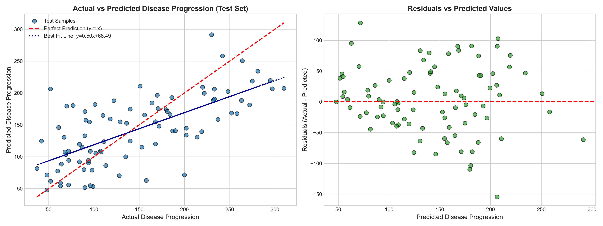
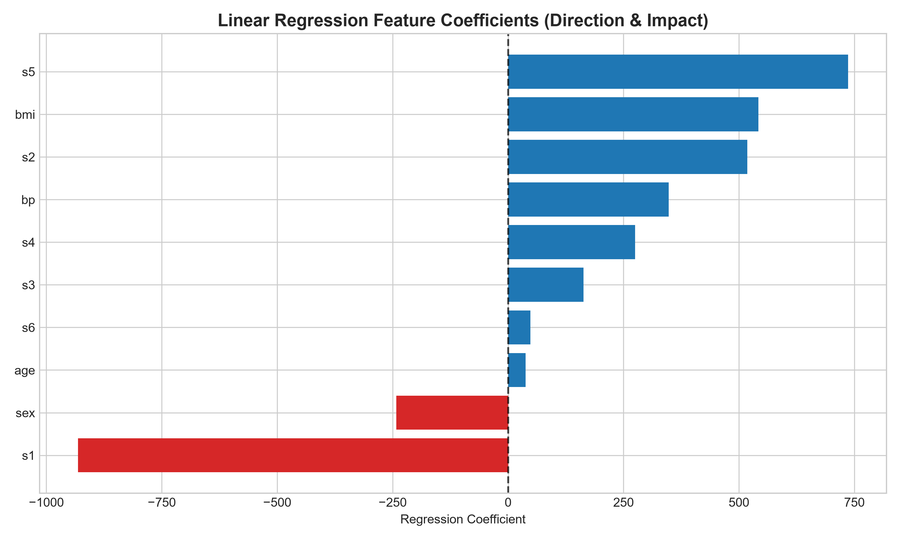
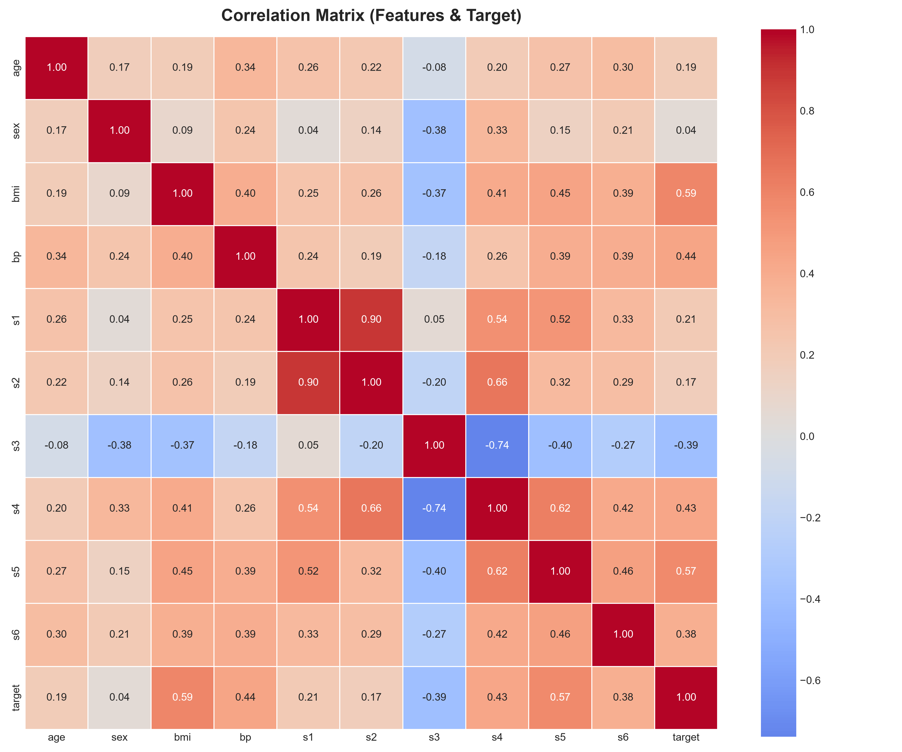

# <p align="center">🩺 Aenexz Internship — Data Science</p>

<p align="center">
  <em>Repository tracking assignments, exploratory data analysis, machine learning models, and real-world projects during the Data Science Internship at <strong>Aenexz Tech Portals</strong>.</em>
</p>

<p align="center">
  <a href="https://github.com/Nav-0019/aenexz_Internship">
    
  </a>
  <a href="https://github.com/Nav-0019/aenexz_Internship">
    
  </a>
  <a href="https://www.python.org/">
    
  </a>
  <a href="https://jupyter.org/">
    
  </a>
  <a href="https://scikit-learn.org/">
    
  </a>
  <a href="https://github.com/Nav-0019/aenexz_Internship/commits/main">
    
  </a>
</p>

---

## 📌 Internship Information

| Detail | Information |
| :--- | :--- |
| **🏢 Organization** | **Aenexz Tech Portals** |
| **💼 Role** | Data Science Intern |
| **🌐 Mode** | Remote |
| **📅 Duration** | September 2026 – November 2026 |
| **🔗 Repository** | [github.com/Nav-0019/aenexz_Internship](https://github.com/Nav-0019/aenexz_Internship) |
| **🎯 Domain** | Data Analysis • Statistical Modeling • Supervised Machine Learning |

---

## 📑 Table of Contents

- [Internship Information](#-internship-information)
- [Internship Objectives](#-internship-objectives)
- [Technologies & Stack](#-technologies--stack)
- [Dynamic Progress Tracker](#-dynamic-progress-tracker)
- [Assignments & Tasks](#-assignments--tasks)
- [Featured Project: Diabetes Progression Prediction](#-featured-project-diabetes-progression-prediction)
- [Repository Structure](#-repository-structure)
- [Development Workflow](#-development-workflow)
- [How to Run Locally](#-how-to-run-locally)

---

## 🎯 Internship Objectives

The primary objectives of this internship are to:

* 🔬 Strengthen core Data Science and Statistical Analysis capabilities
* 🐍 Apply Python programming to solve quantitative, real-world problems
* 🧹 Perform end-to-end data cleaning, preprocessing, and exploratory data analysis (EDA)
* 📊 Build clear, publication-quality data visualizations
* 🤖 Develop, tune, and evaluate Supervised & Unsupervised Machine Learning algorithms
* 📈 Interpret model coefficients, feature impact, and residual metrics
* 🚀 Maintain professional Git and GitHub version-control workflows

---

## 🛠️ Technologies & Stack

| Category | Tools & Libraries |
| :--- | :--- |
| **Languages** | `Python 3.12` |
| **Data Manipulation** | `Pandas`, `NumPy` |
| **Data Visualization** | `Matplotlib`, `Seaborn` |
| **Machine Learning** | `Scikit-Learn` (Regression, Classification, Preprocessing, Metrics) |
| **Environment** | `Jupyter Notebook`, `VS Code` |
| **Version Control** | `Git`, `GitHub` |

---

## 📊 Dynamic Progress Tracker

```text
Overall Internship Completion: [██████████░░░░░░░░░░] 50%
```

| Area | Progress | Completion | Status |
| :--- | :--- | :---: | :---: |
| **Python Fundamentals** | `[████████████████████]` | **100%** |  |
| **Exploratory Data Analysis (EDA)** | `[████████████████████]` | **100%** |  |
| **Supervised Learning (Regression)** | `[████████████████████]` | **100%** |  |
| **Classification Algorithms** | `[░░░░░░░░░░░░░░░░░░░░]` | **0%** |  |
| **Unsupervised Learning & Clustering** | `[░░░░░░░░░░░░░░░░░░░░]` | **0%** |  |
| **Capstone Internship Project** | `[░░░░░░░░░░░░░░░░░░░░]` | **0%** |  |

---

## 📂 Assignments & Tasks

| # | Assignment / Task | Deliverable | Status |
| :-: | :--- | :--- | :---: |
| **01** | **Python Core & Algorithmic Exercises** | [`python_exercises.ipynb`](./python_exercises.ipynb) |  |
| **02** | **Exploratory Data Analysis (EDA)** | [`visualizations/`](./visualizations/) • [Pipeline](./run_diabetes_pipeline.py) |  |
| **03** | **Machine Learning: Diabetes Progression Prediction** | [`diabetes_progression_prediction.ipynb`](./diabetes_progression_prediction.ipynb) |  |
| **04** | **Internship Capstone Project** | `Upcoming Project` |  |

<details>
<summary><strong>🔍 Click to expand Assignment Details</strong></summary>

### 1. Python Exercises (`python_exercises.ipynb`)
- Mathematical functions (circle area calculation, max of numbers)
- String algorithms & custom character counters
- Prime number checking algorithms
- Recursive implementations (Fibonacci sequence, string reversal)

### 2. Machine Learning: Diabetes Progression Prediction (`diabetes_progression_prediction.ipynb`)
- **Dataset:** Scikit-Learn `load_diabetes()` (442 samples, 10 features)
- **Target:** Disease progression score one year after baseline
- **Techniques:** Data profiling, Pearson feature correlation analysis, train-test splitting ($80/20$), Ordinary Least Squares regression, $R^2$/MAE/RMSE evaluation, coefficient analysis, and residual diagnostics.

</details>

---

## 🩺 Featured Project: Diabetes Progression Prediction

<p align="center">
  
</p>

### Key Results & Model Metrics

| Metric | Training Set ($80\%$) | Testing Set ($20\%$) | Note |
| :--- | :---: | :---: | :--- |
| **$R^2$ Score** | **$0.5279$** | **$0.4526$** | Explains $45.3\%$ of disease progression variance on unseen test patients |
| **MAE** | **$43.48$** | **$42.79$** | Average absolute error across progression units |
| **RMSE** | **$53.56$** | **$53.85$** | Consistent training and testing error indicating no overfitting |

<p align="center">
  
  
</p>

<details>
<summary><strong>📈 Top Influential Biomarkers & Clinical Insights</strong></summary>

1. **`bmi` (Body Mass Index) & `s5` (Serum Triglycerides):** Exhibit the strongest positive correlation with disease progression ($r = 0.59$ and $r = 0.57$). Excess adiposity and elevated triglycerides strongly accelerate diabetic severity.
2. **`s1` (Total Cholesterol) & `s2` (LDL Cholesterol):** Demonstrate strong collinearity in the lipid panel; LDL cholesterol shows a direct positive effect on vascular risk.
3. **`bp` (Mean Blood Pressure):** Demonstrates a substantial positive coefficient ($+347.70$), emphasizing that hypertension exacerbates diabetic complications.
4. **`s3` (HDL Cholesterol):** Exhibits a protective negative correlation ($-0.395$), confirming the cardiovascular benefit of "good" cholesterol.

</details>

---

## 🗂️ Repository Structure

```text
aenexz_Internship/
│
├── .gitignore                             # Git ignore rules for virtual environments & caches
├── README.md                              # Dynamic internship dashboard & documentation
│
├── python_exercises.ipynb                 # Assignment 1: Python fundamentals & algorithms
├── diabetes_progression_prediction.ipynb  # Assignment 3: End-to-end ML regression notebook
│
├── run_diabetes_pipeline.py               # Standalone automated ML execution pipeline
├── create_notebook.py                     # Script to generate formatted analysis notebook
│
├── scripts/
│   └── update_readme.py                   # Dynamic script to update progress in README
│
└── visualizations/                        # High-resolution generated charts & plots
    ├── eda_distributions.png              # Feature & target distribution plots
    ├── correlation_heatmap.png            # Correlation matrix heatmap
    ├── target_correlation_bar.png         # Feature correlation with target variable
    ├── feature_importance.png             # Regression coefficient impact & directions
    └── actual_vs_predicted.png            # Actual vs predicted and residual diagnostics
```

---

## 🔄 Development Workflow

```text
Problem Definition & Requirements
              ↓
  Data Loading & Profiling
              ↓
  Exploratory Data Analysis (EDA)
              ↓
  Correlation & Collinearity Analysis
              ↓
  Model Training & Validation Split
              ↓
  Metrics Evaluation (R², MAE, RMSE)
              ↓
  Residual Diagnostics & Insights
              ↓
  Documentation & Version Control
```

---

## 💻 How to Run Locally

### 1. Clone the Repository
```bash
git clone https://github.com/Nav-0019/aenexz_Internship.git
cd aenexz_Internship
```

### 2. Set Up Virtual Environment & Dependencies
```bash
# Create virtual environment
python -m venv .venv

# Activate virtual environment
# Windows:
.venv\Scripts\activate
# Linux/macOS:
source .venv/bin/activate

# Install required packages
pip install scikit-learn pandas numpy matplotlib seaborn
```

### 3. Run Pipeline or Notebook
```bash
# Run the complete automated machine learning pipeline
python run_diabetes_pipeline.py

# Or launch Jupyter Notebook to explore interactively
jupyter notebook diabetes_progression_prediction.ipynb
```

---

<p align="center">
  <strong>Data Science Internship — Aenexz Tech Portals</strong><br>
  <em>Learning • Building • Analyzing • Improving</em>
</p>
